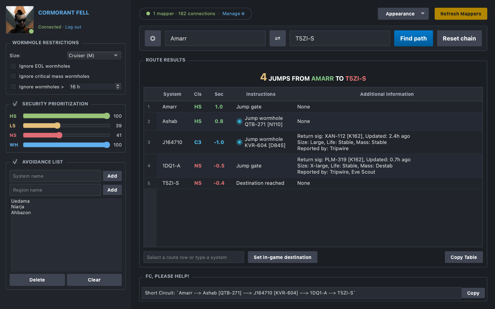
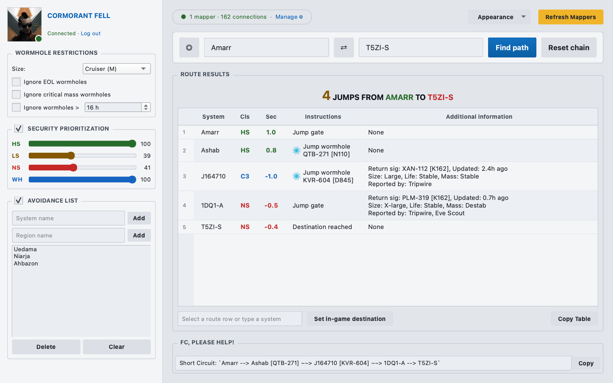
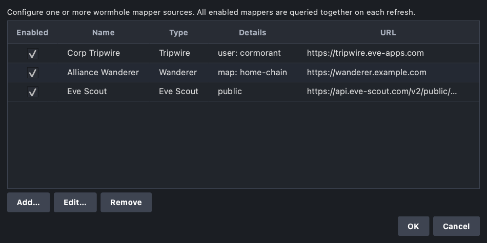

# Short Circuit

[](https://github.com/mogglemoss/shortcircuit/releases)
[](https://github.com/mogglemoss/shortcircuit/actions/workflows/build.yml)

> ⚠️ This is a personal project. It is not ready for primetime and, if past performance is any indicator, it may never be. If you require something stable, maintained, and built by someone who knew what they were doing from the start, please see [secondfry's defacto version](https://github.com/secondfry/shortcircuit). That one has adults in charge. This one has me, [Cormorant Fell](https://evewho.com/character/93594488).



**Short Circuit** is a standalone routing and navigation tool for EVE Online. It calculates the shortest path between solar systems by blending standard stargate routes with live wormhole connections pulled from your favorite third-party mapping tools.

Whether you're running logistics, hunting targets, or daytripping through J-space with the quiet confidence of someone who has absolutely no idea what's on the other side of that wormhole, Short Circuit takes the guesswork out of traversing New Eden — and replaces it with a different, more interesting set of mistakes. Progress.

Since 3.0, this fork is built on [secondfry's](https://github.com/secondfry/shortcircuit) current core (the mapper architecture, the map, the auth) with my layout, themes and extra mappers on top, and the improvements offered back upstream as pull requests.

---

## ✨ Features

**Intelligent Hybrid Routing** calculates optimized paths across High Sec, Low Sec, Null Sec, and Wormhole space in seconds. The routing engine builds a transient graph from live data, computes the shortest path, and silently respects your avoidance lists and wormhole size restrictions without once asking for your reasons. It's doing an enormous amount of math. An acknowledgment would not go unappreciated.

**Multi-Mapper Aggregation** reads several mapping tools at once — your corp's Tripwire, your alliance's Wanderer map, Eve-Scout, and more. Several accounts on the same provider are fully supported, because sometimes you have trust issues and that's fine. When two maps report the same wormhole, Short Circuit matches them by signature, merges them into one connection, and keeps the fresher report. When two genuinely different holes link the same pair of systems, both are kept, and the router picks whichever one your ship can actually use. This is as close to wisdom as software gets.

**Supported mapping platforms:**

- **[Eve-Scout](https://eve-scout.com/)** — Automatic Thera & Turnur connections, delivered silently and without ceremony
- **[Tripwire](https://tripwire.eve-apps.com/)** — Your corp or alliance chain, with your account
- **[Wanderer](https://wanderer.space/)** — Any map you have an API token for
- **[Pathfinder](https://github.com/exodus4d/pathfinder)** — Instances that publish a JSON connections export

**Granular Route Filtering** gives you fine-grained control over which paths Short Circuit will even consider dignifying with a response:

- **Wormhole Restrictions** — Filter by ship size (Frigate, Cruiser, etc.), exclude End of Life holes, exclude critical mass holes, or ignore wormholes older than a specified time limit. For pilots who have learned, through costly experience, that not all holes are created equal.
- **Security Prioritization** — Four sliders (1–100) let you express your nuanced personal feelings about High Sec, Low Sec, Null Sec, and WH space. Equal values disable the feature entirely. Set Null Sec to 100 and the router will heroically thread you through three consecutive wormholes before it will so much as glance at a null gate. The router has opinions. They are adjustable.
- **Avoidance List** — Blacklist specific solar systems or entire regions. Short Circuit does not ask why. Short Circuit understands.

**Launch, Type, Go.** On a returning launch you're logged back in without a browser trip, your current system is already in the Source field, and your mappers have already been fetched. What remains is typing a destination. A ⇄ button swaps Source and Destination for the trip home.

**EVE SSO Integration** (optional) reads your current in-game location and sets waypoints directly in the client. Log in once: the session is kept in your operating system's keychain (macOS Keychain, Windows Credential Manager, or Linux Secret Service), never in a plain file, and resumes on the next launch. The tool works perfectly without it. You'll simply be required to type your location manually, like some kind of animal.

**Fleet-Friendly Exporting** copies your route as clean fleet-chat text (`Jita --> ... --> Iyen-Oursta [HVE-768] ~~> J153528`) or as a full detailed instruction table with jump instructions, signature IDs, and wormhole status — all with a single click. Efficient. Professional. Deeply unlikely to save you from a smartbomb.

**Mapper Status at a Glance** — a pill at the top of the window shows how many mappers are active and how many connections they returned, turns red when a fetch fails, and opens the mapper settings when clicked. Short Circuit fetches once when it starts and otherwise only when you press **Refresh Mappers**: it does not poll anyone's servers while you're not looking. If you route on data more than 15 minutes old, it says so. Stale wormhole data is not a bug. It is a complimentary lesson, delivered at market rates.

**Light, Dark, or Auto** — the **Appearance** menu switches between a dark theme, a light one, and Auto, which follows your operating system. Every piece of text meets the WCAG contrast guideline in both, because squinting is not a feature.



**Corp Brand Packs** — the Appearance menu also takes a corp's brand pack: its colors in both modes, its name on the letterhead, and its emblem in the portrait slot while you're logged out. Packs use the same `brand.json` format as [my Tripwire fork](https://github.com/mogglemoss/tripwire), so one pack themes a corp's map and its router alike. Security and wormhole-class colors never change with the brand: green still means high sec, whoever's colors you're flying.

---

## ESI Scopes

Short Circuit requests exactly two ESI scopes. Not three. Two.

| Scope | Why |
|---|---|
| `esi-location.read_location.v1` | Reads your current system so you don't have to type it |
| `esi-ui.write_waypoint.v1` | Sets your in-game destination automatically |

No wallet. No mail. No corp APIs. No scanning your bookmarks, your contacts, your kill rights, or your browser history. It asks only for what it uses. We understand this is, in the current landscape, a remarkable restraint.

---

## 🚀 Installation

Pre-compiled binaries for macOS (universal), Windows, and Linux (AppImage or tarball) are on the [Releases page](https://github.com/mogglemoss/shortcircuit/releases) for those who prefer their software pre-assembled.

**Running from Source** — Python 3.10–3.13 required. A willingness to read error messages helps but is not strictly mandatory:
```bash
git clone https://github.com/mogglemoss/shortcircuit.git
cd shortcircuit
python -m venv .venv
source .venv/bin/activate  # On Windows: .venv\Scripts\activate
pip install -r requirements.txt
python src/main.py
```

The solar system data ships with the source. Builds refresh it from [Fuzzwork](https://github.com/fuzzysteve)'s SDE dumps. Thank you, fuzzysteve (Steve Ronuken) — a true and tireless pillar of this community, who has quietly enabled more third-party tools than anyone will ever properly document. He deserves more credit than he gets, and he gets quite a lot.

---

## ⚙️ Quick Start

1. **Connect your mappers** — Click the mapper pill at the top (it reads *Mappers not set up · Set up* on a fresh install), then give the default Tripwire entry your account, or add Wanderer, Pathfinder, or Eve-Scout
2. **Log in with EVE** *(optional)* — Click *Log in with EvE* under the portrait, once. From then on you stay logged in, and your location fills the Source field by itself
3. **Set your route** — Type a destination in the route bar (and a source, if you didn't log in)
4. **Configure restrictions** — Set ship size limits, adjust security sliders, and populate your avoidance list based on what you're flying and who is currently motivated to kill you specifically
5. **Hit Find Path** — Jump instructions, signature IDs, and wormhole status appear in the Route Results table. What you do with this information is entirely your own affair.

---

## How It Works

Short Circuit reconstructs its own version of the EVE solar map from the `mapSolarSystemJumps` table of the Static Data Export database — a painstaking process that the software completes in the background without complaint. This base map is then extended with live wormhole connections from every enabled mapper.

Wormhole reports from different mappers are reconciled on the way in:

1. **Matching** — Two reports describe the same wormhole when a signature ID matches on either side. Signatures are unique per system, so one match is decisive. Democracy has limits.
2. **Merging** — Matched reports become one connection that remembers every mapper that reported it, fills in any signature or wormhole type one map was missing, and keeps the fresher report's size, life, and mass. The past is unreliable. We've made our peace with that.
3. **Keeping parallel holes apart** — Two different wormholes between the same pair of systems stay separate, so a destabilized hole doesn't hide a healthy one next to it. The router checks each and takes the cheapest one your restrictions allow.

The route table's *Reported by* line shows which mappers vouched for each hop.

**Security prioritization** assigns an "effort" weight (1–100) to each jump type: HS, LS, NS, and WH. Equal weights across all four disable the system entirely, treating a null sec gate and a high sec gate as morally equivalent, which they are not. Raise any value and the router will work increasingly hard to avoid that jump type — routing around null sec, for instance, until avoiding it would cost more jumps than it saves. Configure it to match your risk tolerance, your ship type, and the number of losses you've had this week.

---

## Managing Mappers



Click the mapper pill to open the **Mappers** dialog: every configured source with its type, a one-line summary (the Tripwire account, the Wanderer map — never a password or token), and an Enabled checkbox. **Add** asks which kind of mapper you want and tells you what each one needs before you commit to anything.

---

## Appearance and Brand Packs

**Appearance** (top right) holds two choices:

- **Mode** — *Auto* follows your operating system's light or dark setting and switches with it; *Light* and *Dark* pin one.
- **Brand** — Short Circuit's own look, or any brand pack you've imported.

To add a corp's pack, choose **Import brand pack…** and pick the pack's folder (the one containing `brand.json`). It's copied into your user data folder, applied immediately, and listed from then on; **Remove** takes it out again. Corp leaders: the pack format is the one documented in [the Tripwire fork's README](https://github.com/mogglemoss/tripwire#brand-packs). Only plain `#rrggbb` colors are accepted, and where a corp's accent would make text hard to read, Short Circuit adjusts the text, never the corp's color.

The public builds ship no corp packs. A corp that wants its own pre-branded build can drop its pack into `src/shortcircuit/brand_packs/` before building; that folder is git-ignored, so a pack never ends up in this repository.

---

## A Note on Reliability

Wormholes are fickle. There's a reason it's called Spooky Space. Routes expire. Intel goes stale. Connections collapse while you're still jumping through them, which is an experience that builds character whether you want it to or not.

**Short Circuit finds the best path based on what is known right now.** It cannot predict the future. It cannot account for the K162 that opened thirty seconds ago. It absolutely cannot stop that cloaked Loki from decloaking directly on your face, and frankly, nothing can.

Fly accordingly.

---

## 🙌 Credits & Acknowledgments

- **[farshield](https://github.com/farshield/shortcircuit)** — Built the original Short Circuit. An absolute legend who started all of this.
- **[secondfry](https://github.com/secondfry/shortcircuit)** — Kept the lights on through years of ESI changes and CCP's creative approach to API stability, and built the modern core this fork now stands on. Also a legend. Arguably more of a legend, given the sustained and thankless nature of the effort.
- **[mogglemoss](https://github.com/mogglemoss/shortcircuit)** / [Cormorant Fell](https://evewho.com/character/93594488) — Added Wanderer and Pathfinder support, themes and brand packs, made it prettier, introduced an undisclosed number of new bugs, and wrote this README. Proud boomerang of [WiNGSPAN Delivery Services](https://www.torpedodelivery.com/), where the torpedoes were always free and the targets were always surprised.

---

## License

MIT. Do what you want with it. Fork it, improve it, quietly fix my bugs and pretend they were always yours. Just don't blame me when you jump a crit hole and lose your billion-ISK pod.

That one is entirely on you. We both know it. 

---

Fly weird,

— [Cormorant Fell](https://evewho.com/character/93594488), probably

---

*This tool uses the [EVE Online ESI API](https://esi.evetech.net). It is not affiliated with or endorsed by CCP Games. EVE Online, EVE, the EVE logo, and all related art, images, and materials are the intellectual property of CCP hf., used with permission under the [CCP Developer License Agreement](https://developers.eveonline.com/resource/license-agreement).*
